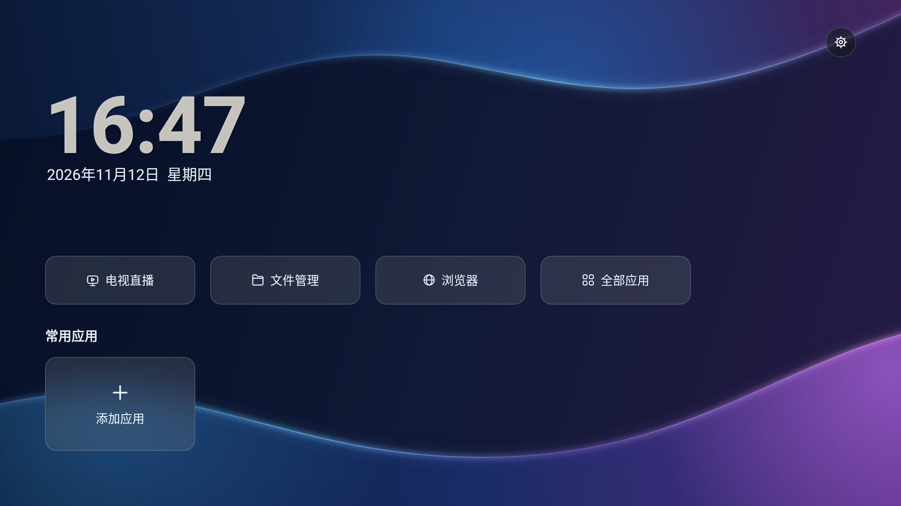
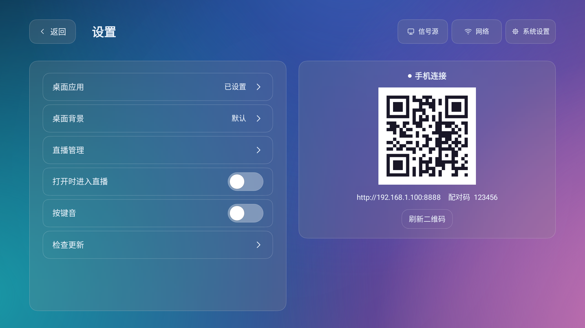

# OneTV

Android TV 桌面，内置直播、浏览器、手机遥控和局域网文件传输。

[下载 OneTV](https://github.com/MrJelly/OneTV/releases/latest) · [反馈问题](https://github.com/MrJelly/OneTV/issues)

| 首页 | 控制中心 |
| --- | --- |
|  |  |

## 功能

- 默认桌面、开机启动、常用应用、壁纸与信号源切换
- 内置直播、节目单导入、频道收藏与线路切换
- 网页浏览、全屏播放与遥控进度调整
- 手机扫码遥控、文字输入与文件传输

## 安装

支持 Android 4.4 及以上。32 位设备选 ARMv7，64 位设备选 ARM64，不确定时选通用包。

## 构建

安装 JDK 17、Android SDK 35 和 Build Tools 35.0.0，运行 `./gradlew :app:assembleDebug`。Windows 使用 `gradlew.bat`。

## 许可

[GPL-3.0](COPYING) · [第三方许可与原生依赖](SOURCE.md)
