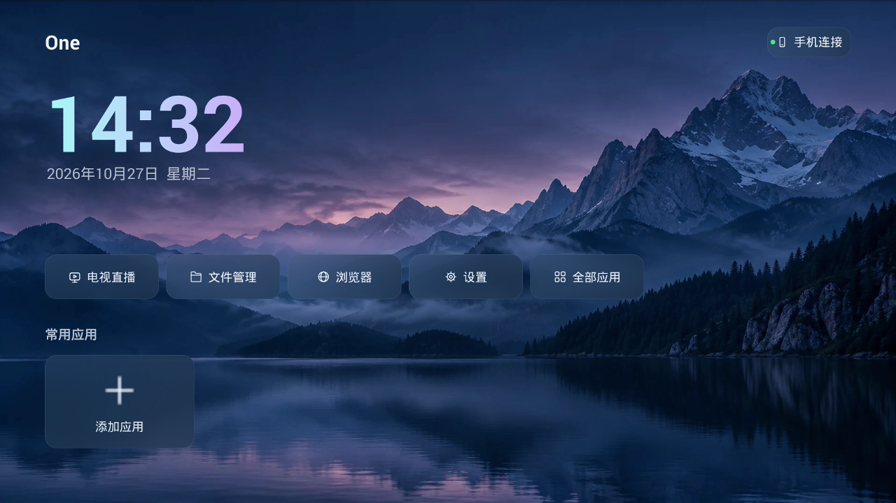
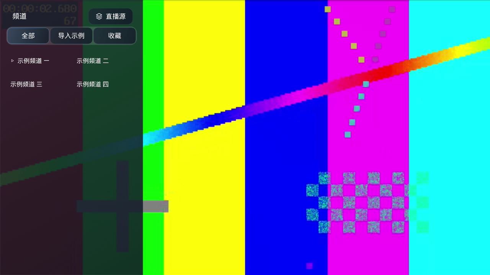
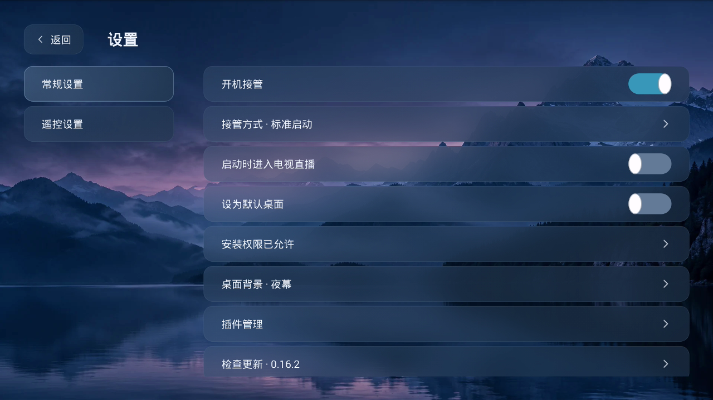
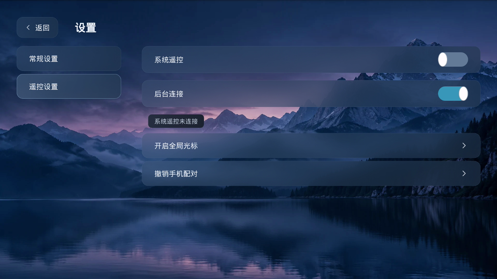

# OneTV

One 是面向 Android 电视、盒子、投影仪和手机横屏的桌面与通用播放器。支持常用应用、用户自定义直播源、网页浏览，以及局域网手机遥控和文件传输。

[下载最新版本](https://github.com/MrJelly/OneTV/releases/latest)

## 界面预览

| 首页 | 频道列表 |
| --- | --- |
|  |  |
| 常规设置 | 遥控设置 |
|  |  |

界面中的背景、应用和频道为使用示例，频道由用户自行配置。

## 主要功能

- **电视桌面**：添加常用应用、打开全部应用、自定义壁纸，支持浅色与深色外观。
- **通用播放器**：导入节目单或添加直播直链，按分类查看频道，收藏常看内容，记住上次播放的频道。
- **手机遥控**：扫码连接，支持方向键、滑动光标和发送文字；手机网页保留独立的浅色主题。
- **文件管理**：局域网上传文件，预览图片和视频，通过系统安装器安装 APK。
- **网页浏览**：网址输入、光标操作、页面缩放和网站收藏。
- **检查更新**：在设置中获取公开 Release 的最新主应用版本。

## 下载与安装

1. 在 [Releases](https://github.com/MrJelly/OneTV/releases/latest) 下载 `One-版本号.apk`。
2. 将 APK 复制或上传到设备，按系统提示允许安装。
3. 首次打开后添加常用应用；需要直播时，自行导入有合法授权的节目单或播放地址。

主应用最低支持 **Android 4.4**，默认安装包覆盖 **ARM32 / ARM64**。桌面接管、开机启动、系统遥控和 APK 安装等能力受设备固件及授权影响。

本次公开 Release 仅发布主应用，**不包含独立直播插件 APK**。主应用与插件分别安装、分别更新。

## 自定义背景

在“设置 → 桌面背景”上传图片。默认根据整张图片亮度自动选择配色，也可通过“自定义配色”指定浅色或深色，选择会被记住。自定义背景下的文字区域和按钮带有底色，减少照片明暗混合造成的干扰。

## 手机连接

1. 手机与大屏设备连接同一局域网。
2. 在 One 首页右上角打开“手机连接”，使用手机浏览器扫码。
3. 完成连接后，可使用遥控、文件传输和频道管理。

二维码过期时可以刷新。仅控制 One 内的界面不需要系统遥控；跨应用控制需要在“遥控设置”中启用相应能力并完成系统授权。

## 添加与播放频道

应用不提供直播源。可从直播页的“直播源”入口添加订阅，或通过手机网页导入 M3U、TXT、JSON、PLS、CSV、XSPF 等节目单。

| 播放方式 | 支持范围 |
| --- | --- |
| HLS / DASH | 常见自适应直播与点播 |
| Smooth Streaming | 对应格式的直播与点播 |
| RTSP | 支持的网络摄像头及流媒体地址 |
| UDP MPEG-TS | 局域网单播或组播，需网络设备支持 |
| HTTP / HTTPS 直链 | 支持的 MP4、MKV 等媒体文件 |

播放器优先使用设备解码器，可用时提供音视频软解兜底。实际播放能力取决于编码、网络、源站和设备性能；软解不能保证所有高分辨率内容流畅。旧设备的网站浏览和播放能力还取决于系统 WebView。

## 更新

在 **设置 → 检查更新** 中下载最新主应用，也可从 Release 手动下载安装。覆盖安装时请保持签名一致，避免卸载造成订阅、收藏或文件丢失。

## 使用声明与免责声明

本项目仅供个人学习、研究与交流，请勿用于商业用途。下载后请在 24 小时内删除。

本软件仅作为通用播放器工具按 **「现状」** 提供，作者及贡献者 **不对** 因使用本软件造成的任何直接、间接、偶然或后果性损害承担责任，包括但不限于：设备故障、数据丢失、流量费用、服务中断或内容合规争议等。

1. 应用 **不内置、不提供、不分发任何直播源或节目内容**；用户需自行导入并仅使用已获得合法授权的地址。
2. 播放内容来自用户配置的第三方地址，本应用 **不控制、不审核、不托管、不缓存分发** 相关内容；应用仅提供本地播放能力。
3. 用户应自行确认其订阅地址、节目内容与使用行为符合所在地法律法规及服务条款；由此产生的风险与责任均由用户自行承担。
4. 本声明不排除适用法律规定的强制性责任条款；若你不同意上述内容，请 **不要使用** 本软件。

## 开发与许可

开发者可查看 [构建说明](docs/DEVELOPMENT.md)。本版本主应用的对应源码见对应版本 Release 的 **Source code** 下载项，不包含直播插件和签名私钥。

原创代码许可见 [LICENSE](LICENSE)。第三方组件保留各自许可，见 [组件许可证](app/src/main/assets/licenses/) 及包内 `assets/licenses/`；包含 FFmpeg / NextLib 的组合安装包亦须遵循 GPL-3.0，使用声明不替代这些许可证。
